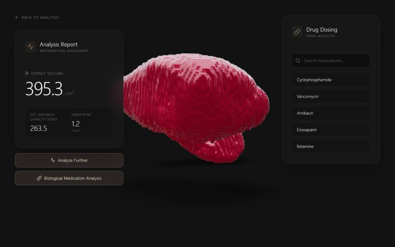
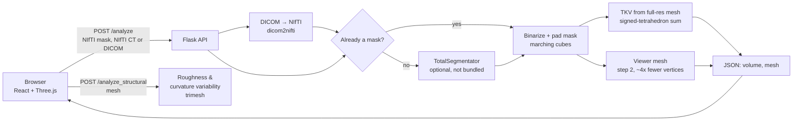

# NephroRx

**NephroRx measures Total Kidney Volume (TKV) from a CT/MRI kidney segmentation and shows the
kidney as an interactive 3D mesh in the browser.** You upload a NIfTI mask or a DICOM series. A
Python pipeline meshes the kidney with marching cubes and computes its volume from the mesh. It
also scores surface roughness and curvature variability. A React + Three.js viewer renders the
mesh so you can rotate and inspect it. Built in 3 days at a hackathon (November 2025) by a team
of three.



## Measured result

On **50 public KiTS23 CT scans**, NephroRx's TKV is within **0.027% mean (0.092% max)** of the
voxel-count volume of the expert ground-truth masks. It takes **0.58 s median per scan** on one
CPU core. The original hackathon code had 1.02% mean / 4.5% max error. Method, before/after
numbers and reproduction steps are in [`bench/README.md`](bench/README.md).

## How it works



| Piece | Where | Notes |
|---|---|---|
| Imaging pipeline | [`backend/processing.py`](backend/processing.py) | DICOM → NIfTI. Detects whether the input is already a label mask. |
| Geometry + volume | [`backend/calculations.py`](backend/calculations.py) | Marching cubes (scikit-image), mesh volume via the divergence theorem, roughness = surface area / area of a sphere of equal volume. |
| API | [`backend/app.py`](backend/app.py) | `POST /analyze`, `POST /analyze_structural` |
| 3D viewer | [`frontend/src/components/KidneyModel.jsx`](frontend/src/components/KidneyModel.jsx), [`KidneyViewer.jsx`](frontend/src/components/KidneyViewer.jsx) | Builds a `BufferGeometry` from the API mesh, react-three-fiber + drei. |
| Benchmark | [`bench/`](bench/) | TKV accuracy and latency against KiTS23 ground truth. |

## Run it locally

Requires Python 3.11+ and Node 20+. Tested on Windows 11 with Python 3.14 and Node 26.

```bash
git clone https://github.com/NephroRx/NephroRx && cd NephroRx

# 1) API on http://localhost:5000
cd backend
python -m venv .venv
.venv/Scripts/activate          # macOS/Linux: source .venv/bin/activate
pip install -r requirements.txt
python app.py

# 2) Web app on http://localhost:3000 (second terminal)
cd frontend
npm ci
npm start
```

Scroll down, click **"Or use sample scan for testing"**, then **Calculate**. The bundled sample
is a kidney + tumor ground-truth mask that appears to be KiTS case_00000.

**Docker** (one command, serves on http://localhost:8080; nginx proxies `/api` to Flask):

```bash
docker compose up --build
```

Production adds Caddy for HTTPS: `docker compose -f docker-compose.yml -f docker-compose.prod.yml up -d --build`.

**Tests:** `cd frontend && npm test`. CI also builds the frontend with lint warnings treated as
errors, runs the TKV check on the sample, and runs an end-to-end Docker request ([`.github/workflows/ci.yml`](.github/workflows/ci.yml)).

## Limitations

This is a hackathon prototype, **not a medical device**:

* **Only the kidney volume is benchmarked.** The other metrics shown in the app, including the
  roughness and curvature thresholds, are hackathon heuristics with no clinical validation.
* **Raw CT segmentation is optional.** Uploading an unsegmented scan calls
  [TotalSegmentator](https://github.com/wasserth/TotalSegmentator), which is not in
  `requirements.txt` (it needs PyTorch, and a GPU to run at practical speed). It also segments
  only the right kidney (`--roi_subset kidney_right`). Segmentation masks work out of the box.
* **The hosted demo is offline.** The frontend at nephro-rx.vercel.app is up, but its backend
  server is down. Run it locally instead.

## Team

| | Focus |
|---|---|
| **Bharat Jassal** | Imaging pipeline and 3D visualization: DICOM/NIfTI processing, marching-cubes meshing and Total Kidney Volume, the Three.js kidney viewer |
| **Ben Probert** | Surface analysis and app integration: roughness and curvature metrics, the Flask API, results and analysis pages |
| **Jasjeet Singh Soor** | Landing page and upload flow, deployment (Docker, Caddy, Vercel) |

Sample data and benchmark masks come from the KiTS challenge (Heller et al.). See the
[KiTS23 repository](https://github.com/neheller/kits23) for its license and citation.
